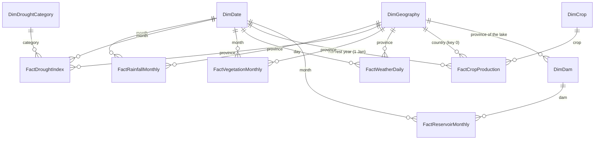

# Data warehouse: design and data dictionary

Database `DWH_DB` (SQL Server 2025). Raw data first lands in `Staging_DB` (schema `stg`), then
the load procedures (`dbo.usp_Load*`) move it into this star schema.

## 1. Star schema

Each **fact** table (the numbers) points to **dimension** tables (who / where / when / what).

| Fact table | Grain (one row = ...) | Period | Rows | Source |
|---|---|---|---|---|
| `FactRainfallMonthly` | province × month | 1991-01 → 2026-10 | 32,250 | CHIRPS v3 |
| `FactDroughtIndex` | province × month × SPI scale (1/3/6/12) | 1991 → 2026-10 | 127,578 | computed from CHIRPS |
| `FactVegetationMonthly` | province × month | 2000-02 → 2026-10 | 24,075 | MODIS + ESA WorldCover (Earth Engine) |
| `FactReservoirMonthly` | dam × month | 2000-01 → 2026-11 | 8,398 | JRC (Landsat) 2000-2016 + Sentinel-2 2017+ (Earth Engine), OpenStreetMap outlines |
| `FactCropProduction` | crop × year (national) | 2000 → 2024 | 2,546 | FAOSTAT |
| `FactWeatherDaily` | province × day | 1991-01-01 → 2026-11-11 | 982,425 | Open-Meteo (ERA5) |

All foreign keys are enforced and trusted, so a fact row can't point to a province, date,
crop, dam or category that doesn't exist.

## 2. Design decisions

| Decision | Why |
|---|---|
| Separate `Staging_DB` and `DWH_DB` | A bad file can never damage the data the dashboards use |
| Monthly facts use `DateKey` = 1st of the month; yearly facts use 1 January | One date dimension serves daily, monthly and yearly facts; 1 January of harvest year *Y* falls in agricultural season *Y-1/Y* |
| Country row `GeographyKey = 0` | FAOSTAT is national only; it uses the same dimension as provinces |
| Normals and anomalies stored in the facts | Computed once at load time, same definition everywhere (rain 1991-2020, NDVI 2001-2020) |
| SPI in long format (one row per scale) | One measure works for SPI-1, 3, 6, 12 with a scale filter |
| Loads with `MERGE`, updating only changed rows | Re-running a load changes nothing; a new month only adds that month (checked by `etl.LoadAudit`) |
| Non-clustered columnstore indexes on the 4 largest facts | Faster analytical queries; primary keys kept for loads |
| No table partitioning | Largest table ~1 M rows; partitioning pays off from tens of millions of rows |

## 3. Data dictionary

### Dimensions

**`DimDate`**: one row per day, 1940-01-01 → 2030-12-31 (33,238 rows)
| Column | Type | Meaning |
|---|---|---|
| DateKey | int | yyyymmdd, e.g. 20240315 (primary key) |
| Date | date | the day |
| Year, Quarter, Month, Day, DayOfYear | int types | calendar parts |
| MonthNameFr / MonthNameAr | nvarchar | Janvier... / يناير... (Moroccan usage) |
| YearMonth | char(7) | '2024-03' |
| MonthStart | date | first day of the month |
| IsoWeekday, DayNameFr, IsWeekend | | 1 = Monday ... 7 = Sunday |
| AgriSeasonStartYear, AgriSeason, AgriSeasonMonthNo | | season September → August, e.g. '2023-24'; September = 1 |
| HijriYear, HijriMonth, IsRamadan | | Umm al-Qura calendar (Morocco is often 1 day later) |

**`DimGeography`**: 75 provinces/prefectures + country row (key 0)
| Column | Type | Meaning |
|---|---|---|
| GeographyKey | int | primary key (0 = Maroc) |
| GeoLevel | varchar | 'Province' or 'Country' |
| HcpCode | int | official HCP geographic code |
| ProvinceName / ProvinceShort | nvarchar | "Province de Settat" / "Settat" (HCP names) |
| ProvinceType | nvarchar | Province / Préfecture / Pays |
| RegionCode, RegionName | | 12 regions (2015 division) |
| ShapeID | varchar | link to the outline in the geoBoundaries map file |
| AreaKm2 | decimal | area of the outline |
| PointLat / PointLon | decimal | a point inside the province (weather requests) |
| Pop2024, PopUrban2024, PopRural2024 | int | legal population, HCP census 2024 |
| RuralSharePct | computed | rural population share |

**`DimCrop`**: 103 FAOSTAT crops
| Column | Meaning |
|---|---|
| CropKey | primary key |
| FaoItemCode | FAOSTAT item code (15 = wheat, 44 = barley) |
| CropNameEn / CropNameFr | names (French for the main crops) |
| CropGroup | Céréales, Agrumes, Arboriculture, Légumineuses, Cultures sucrières, Autres |
| IsAggregate | FAOSTAT totals such as "Cereals, primary" |
| IsKeyCrop | the 10 crops shown by default |

**`DimDroughtCategory`**: 7 SPI classes (McKee et al. 1993)
| Key | Category | SPI range | Drought? |
|---|---|---|---|
| 1 | Extrêmement humide | ≥ 2.0 | no |
| 2 | Très humide | 1.5 to 2.0 | no |
| 3 | Modérément humide | 1.0 to 1.5 | no |
| 4 | Proche de la normale | -1.0 to 1.0 | no |
| 5 | Sécheresse modérée | -1.5 to -1.0 | yes |
| 6 | Sécheresse sévère | -2.0 to -1.5 | yes |
| 7 | Sécheresse extrême | ≤ -2.0 | yes |
Each class also has a `ColorHex` for maps.

**`DimDam`**: 26 reservoirs ≥ 4 km² (OpenStreetMap)
| Column | Meaning |
|---|---|
| DamKey | primary key |
| DamName | name (natural key) |
| GeographyKey | province where the lake is |
| OsmAreaKm2 | lake outline area in OpenStreetMap |
| Lat / Lon | a point on the lake |
| MaxWaterKm2 | largest water surface observed by Sentinel-2 in a reliable month |

### Facts

**`FactRainfallMonthly`**
| Column | Meaning |
|---|---|
| DateKey, GeographyKey | month, province |
| RainMm | average rainfall over the province's ~5 km pixels (mm = litres per m²) |
| NormalMm | average of the same month over 1991-2020 |
| AnomalyPct | RainMm as % of normal (100 = normal) |

**`FactDroughtIndex`**
| Column | Meaning |
|---|---|
| DateKey, GeographyKey | month, province |
| SpiScale | 1, 3, 6 or 12 months of accumulated rain |
| SpiValue | Standardized Precipitation Index (0 = normal, -1 moderately dry, -2 extremely dry) |
| DroughtCategoryKey | class from `DimDroughtCategory` |

**`FactVegetationMonthly`**
| Column | Meaning |
|---|---|
| DateKey, GeographyKey | month, province |
| NdviCrop | greenness of farmland (0 bare → 0.5+ dense green); NULL if no farmland |
| NdviAll | greenness of all land |
| CropSharePct | share of the province that is farmland |
| NdviCropNormal / NdviAllNormal | average of the same month over 2001-2020 |
| NdviCropAnomaly / NdviAllAnomaly | difference from normal (negative = less green than usual) |

**`FactReservoirMonthly`**
| Column | Meaning |
|---|---|
| DateKey, DamKey | month, dam |
| WaterKm2 | water surface measured by Sentinel-2 |
| ClearPct | share of the lake seen without clouds |
| IsReliable | ClearPct ≥ 80 % |
| FillIndexPct | WaterKm2 / MaxWaterKm2 × 100 (surface, not volume) |
| Source | 'JRC' (Landsat, 2000-2016) or 'S2' (Sentinel-2, 2017 onwards) |

**`FactCropProduction`**
| Column | Meaning |
|---|---|
| DateKey | 1 January of the harvest year |
| GeographyKey | 0 (national) |
| CropKey, Year | crop, harvest year |
| AreaHa / YieldKgHa / ProductionT | harvested area, yield, production |
| Source | 'FAOSTAT' |

**`FactWeatherDaily`**
| Column | Meaning |
|---|---|
| DateKey, GeographyKey | day, province (point inside the province) |
| TmaxC / TminC | max / min air temperature at 2 m (°C) |
| PrecipMm | precipitation (mm) |
| Et0Mm | FAO-56 reference evapotranspiration (mm): water the air "takes" from soil and plants |

### Technical tables
| Table | Meaning |
|---|---|
| `dbo.MapProvince` | reviewed HCP ↔ geoBoundaries name matches (75 rows) |
| `etl.RunLog` | one row per SSIS package run: start, end, rows, Success/Failed, error text |
| `etl.LoadAudit` | one row per load procedure call: rows offered, inserted, updated, unchanged |
